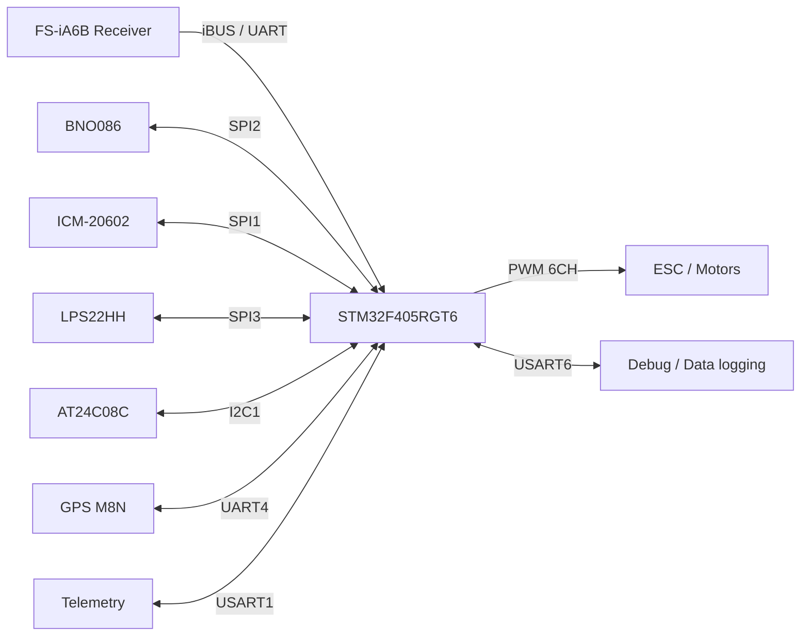

# STM32 Flight System

**STM32 기반 드론 비행제어 시스템을 회로 설계부터 제어 모델·펌웨어·실제 시험까지 연결하는 개인 개발 프로젝트입니다.**

**현재 단계 · 2026-11-02:** 하드웨어 설계 및 R10/R11 제조 데이터의 로컬 정합성 검토를 마쳤습니다. PCB 제조·SMT는 Global Sourcing 부품 입고와 제조사 수락·공정 승인 대기 상태입니다. 제어 모델, 프로젝트 펌웨어 통합, 실제 보드 동작 및 비행 검증은 앞으로 진행합니다.

## Contents

1. [Project Overview](#1-project-overview)
2. [Development Status](#2-development-status)
3. [System Architecture](#3-system-architecture)
4. [Hardware Design — LKM_FC_V1](#4-hardware-design--lkm_fc_v1)
5. [MATLAB/Simulink Control Development](#5-matlabsimulink-control-development)
6. [STM32 Firmware Implementation](#6-stm32-firmware-implementation)
7. [Drone Assembly & Integration](#7-drone-assembly--integration)
8. [Sensor Data Visualization](#8-sensor-data-visualization)
9. [Bench Testing & Flight Validation](#9-bench-testing--flight-validation)
10. [Documentation & Repository Structure](#10-documentation--repository-structure)

## 1. Project Overview

회로와 PCB를 직접 설계하고, 센서 데이터를 이용하는 제어 알고리즘을 MATLAB/Simulink에서 모델링한 뒤 STM32 펌웨어와 실제 기체로 연결하는 것을 목표로 합니다. 설계 결정의 근거와 검증 범위를 기록하여, 제조 데이터 검토부터 실물 시험까지 추적할 수 있도록 구성했습니다.

저장소 Description 초안:

> STM32 기반 드론 비행제어 시스템 End-to-End 개발 | FC PCB 설계, MATLAB/Simulink 제어 모델링, 펌웨어 구현 및 실제 비행 검증

위 설명은 프로젝트의 **전체 개발 목표**입니다. 펌웨어 구현·실제 비행 검증 완료를 의미하지 않습니다.

## 2. Development Status

| 영역 | 현재 상태 | 확인할 자료 / 다음 작업 |
|---|---|---|
| 회로 설계 | 설계 완료 | Power, MCU, Sensors, UART, PWM/User I/O의 5개 시트 |
| PCB Layout | 설계 완료 | 36×36 mm, 4-Layer, R2.5 모서리, 1.2 mm 제조 조건 |
| 센서·전원·통신 회로 | 설계 완료 | BNO086, ICM-20602, LPS22HH, 보호 전원 및 외부 I/O |
| Gerber / Drill / BOM / CPL | 출력·로컬 대조 완료 | R10/R11 기록, 공장 BOM 52 MPN 그룹 / 139개 실장 위치 |
| 공개용 PDF | 파일 확보·복사 완료 | 회로도 5페이지, PCB 4페이지, BOM 2페이지 |
| 제조·SMT | 대기 | 부품 입고 및 제조사 수락·CAM·조립 공정 승인 |
| MATLAB/Simulink | 예정 | 모델, 시뮬레이션, C 코드 생성 |
| STM32 펌웨어 | 예정 | 보드 bring-up, 센서 드라이버, 제어 코드 통합 |
| 센서 시각화·기체 통합 | 예정 | 실시간 로깅, 기구·전원·ESC 연결 |
| Bench / Flight Validation | 미실시 | 실제 LKM_FC_V1 하드웨어에서 측정·시험 후 기록 |

로컬 CAM 검토는 제조 데이터와 저장 설계의 일치를 확인한 결과입니다. 전기 동작·EMI·비행 성능을 입증하는 시험 결과와 구분합니다.

## 3. System Architecture

아래는 설계된 하드웨어 연결과 앞으로 구현할 제어 흐름입니다. 제어 연산 및 실제 ESC 동작은 아직 통합 검증하지 않았습니다.



외부 BEC의 5 V는 보호 회로와 LDO를 통해 보드 전원을 공급하며, 배터리 전압은 별도의 보호·분압 회로에서 측정합니다. [시스템 구성 상세](docs/system-architecture.md)

## 4. Hardware Design — LKM_FC_V1

| 항목 | 설계 사양 |
|---|---|
| MCU | STMicroelectronics STM32F405RGT6, LQFP64 |
| IMU | CEVA BNO086 / TDK InvenSense ICM-20602 |
| Barometer | STMicroelectronics LPS22HH |
| EEPROM | Microchip AT24C08C |
| Power Protection | TPS259531 eFuse, TVS, 역극성 보호 |
| LDO | TPS7A9001, 3.3 V rail |
| Communication | SPI, I²C, UART |
| RC Input / ESC Output | iBUS / PWM 6CH |
| Debug | SWD, UART, Status LED, Buzzer |
| PCB | 36×36 mm, 4-Layer, 1.2 mm 제조 조건 |
| CAD | Altium Designer 26.3 |

설계의 주요 검토 대상은 MCU 전원·VCAP·클록, 센서 디커플링, SPI 귀환 경로, 전원 기동, 외부 신호 보호, 장착홀과 커넥터의 간섭입니다. 제조 데이터는 저장 PCB와 구리·드릴·부품배치를 대조했습니다.

- [회로도](hardware/LKM_FC_V1/schematic/LKM_FC_V1_Schematic.pdf): 5개 회로 블록
- [PCB Layout](hardware/LKM_FC_V1/pcb-layout/LKM_FC_V1_PCB_Layout.pdf): Top / Inner 1 / Inner 2 / Bottom
- [Assembly BOM](hardware/LKM_FC_V1/bom/LKM_FC_V1_BOM.pdf): 공장 실장용 52 MPN 그룹 / 139개 위치. 전체 회로도 부품 목록과는 범위가 다릅니다.
- [설계 설명](docs/hardware-design.md) · [제조 데이터 관리](hardware/LKM_FC_V1/manufacturing/README.md)

PDF는 2026-11-02에 확보한 문서 스냅샷입니다. 회로·레이어 내용은 유지하고, 공개용 회로도·PCB PDF의 개인 저자 메타데이터만 제거했습니다. R10/R11 검증은 해당 릴리스 시점의 증거로 구분합니다. 공개 PDF 자체를 발주용 Gerber나 새로운 제조 승인으로 취급하지 않습니다.

## 5. MATLAB/Simulink Control Development

**계획 단계입니다.** 센서 좌표계와 단위를 정의한 뒤 자세·각속도 제어 모델, PID 및 Motor Mixing을 구성할 예정입니다. 시뮬레이션의 입력 조건과 응답을 기록하고, 생성한 C 코드를 STM32의 실제 샘플링 주기 및 센서 데이터 경로와 통합합니다.

모델은 `control/simulink/`, MATLAB 분석은 `control/matlab/`, 재현 가능한 시뮬레이션 결과는 `control/simulations/`에 추가합니다. 현재 모델·게인·시뮬레이션 결과는 없습니다.

## 6. STM32 Firmware Implementation

**보드 전용 구현·통합은 예정입니다.** STM32/C와 HAL 기반 초기화, 센서 드라이버, iBUS 수신, PWM 출력, EEPROM 설정 관리, Debug/Telemetry 순서로 bring-up할 계획입니다. BNO086의 시작·reset/wake·SHTP/SH-2 통신과 실제 센서 축 방향은 실물에서 확인합니다.

기존 공개 강의 펌웨어는 이번 저장소에 복사하지 않았습니다. 기존 참고 보드의 동작 결과를 LKM_FC_V1의 펌웨어 검증으로 사용하지 않습니다. [펌웨어 구성 계획](docs/firmware-architecture.md) · [코드 추가 원칙](firmware/README.md)

## 7. Drone Assembly & Integration

**기체 통합은 예정입니다.** QAV210 계열 프레임, 외부 BEC, FS-iA6B 수신기, M8N GPS, Telemetry, ESC 및 모터와의 연결을 확인한 뒤 커스텀 PCB를 장착합니다. 기구 간섭, 진동 전달, 센서 축과 기체 축, 모터 번호 및 회전 방향을 실제 조립 상태에서 기록합니다.

PWM 6CH는 한 개의 18핀 헤더 J8로 구성했습니다. J1·J4·J5·J8은 수동 납땜, Molex J2·J3는 공장 조립 대상입니다. 기체 조립 사진과 전원 배선 기록은 `media/assembly/`에 추가할 예정입니다.

## 8. Sensor Data Visualization

**실측 데이터는 아직 없습니다.** IMU·기압·배터리 전압을 timestamp와 함께 수집하고, 단위·좌표계·샘플링 조건·펌웨어 버전을 데이터와 같이 기록합니다. 노이즈, bias, 데이터 누락과 지연을 분석한 뒤 그래프를 게시합니다.

원본 측정 데이터는 `testing/sensor-data/`, 그래프는 `testing/plots/`에 보관합니다. 예시 데이터를 실제 측정처럼 표시하지 않습니다.

## 9. Bench Testing & Flight Validation

**실제 LKM_FC_V1 보드 시험 및 비행 시험은 미실시입니다.** 전원과 SWD, 센서, 통신, 프로펠러를 제거한 ESC/PWM 시험, 기체 통합, 단계적 비행 검증 순으로 진행합니다.

시험 기록에는 보드/펌웨어 버전, 장비·조건, 합격 기준, 측정값, 이상 현상과 재시험 결과를 남깁니다. 제조 데이터 검토와 실물 시험을 분리한 [검증 계획 및 현재 근거](docs/validation.md)를 따릅니다.

## 10. Documentation & Repository Structure

```text
STM32-Flight-System/
├── README.md
├── .gitignore
├── hardware/LKM_FC_V1/
│   ├── schematic/          # 회로도 PDF
│   ├── pcb-layout/         # 4개 Copper Layer PDF
│   ├── bom/                # 공장 Assembly BOM PDF
│   ├── 3d-view/            # 현재 이미지 제외
│   └── manufacturing/     # 출력·검증 과정 설명
├── firmware/
│   ├── stm32/             # 보드 초기화·애플리케이션 예정
│   ├── drivers/           # 센서·통신 드라이버 예정
│   ├── generated/         # 추적 가능한 생성 C 코드 예정
│   └── README.md
├── control/
│   ├── simulink/
│   ├── matlab/
│   └── simulations/
├── testing/
│   ├── sensor-data/
│   ├── plots/
│   ├── bench-tests/
│   └── flight-tests/
├── media/
│   ├── hardware/
│   ├── assembly/
│   ├── gifs/
│   └── flight-videos/
└── docs/
    ├── system-architecture.md
    ├── hardware-design.md
    ├── firmware-architecture.md
    └── validation.md
```

빈 폴더는 `.gitkeep`으로 유지합니다. 공개 범위는 PDF·선별 이미지·기술 설명 중심입니다. 원본 Altium 프로젝트·라이브러리, 전체 제조 ZIP, 구매·계정 기록, 내부 로그 및 MCP 설정은 포함하지 않습니다. 새로운 LICENSE를 부여하지 않았으며, 향후 외부 코드를 포함할 때는 해당 출처와 라이선스를 별도로 검토합니다.
