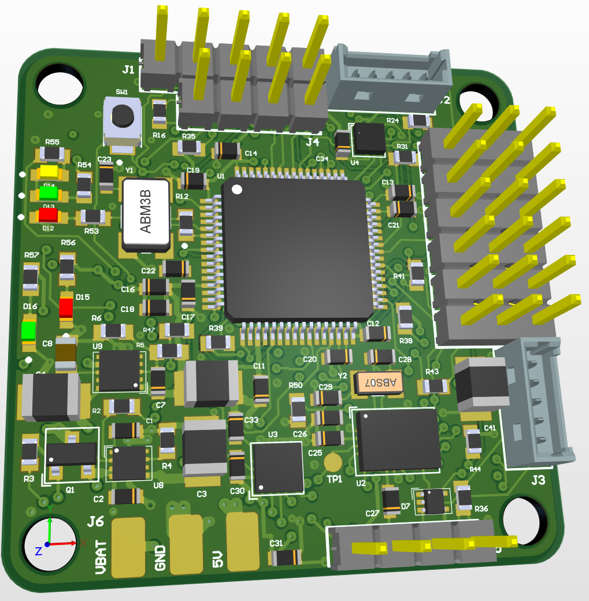
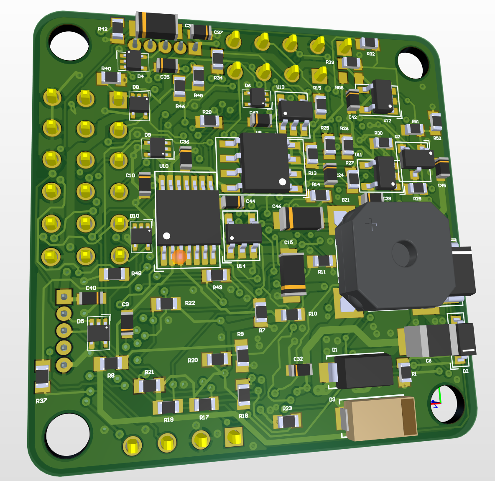
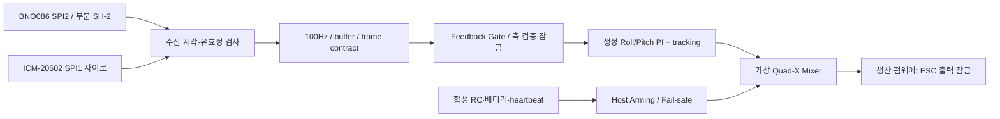
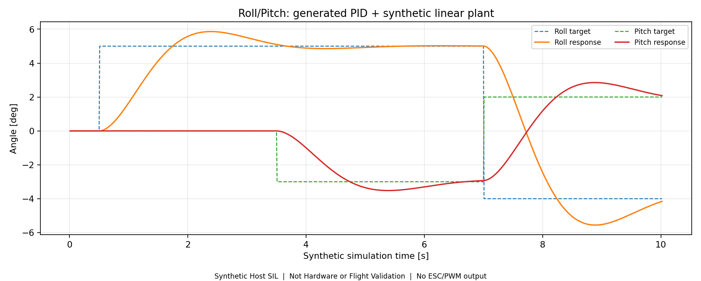
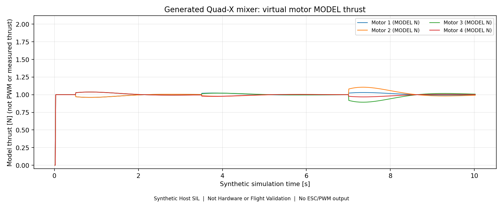
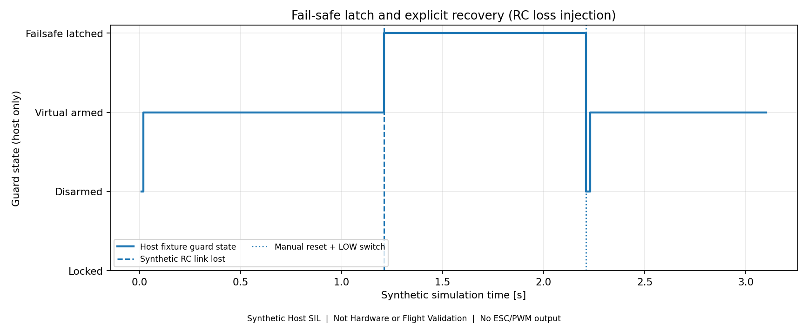
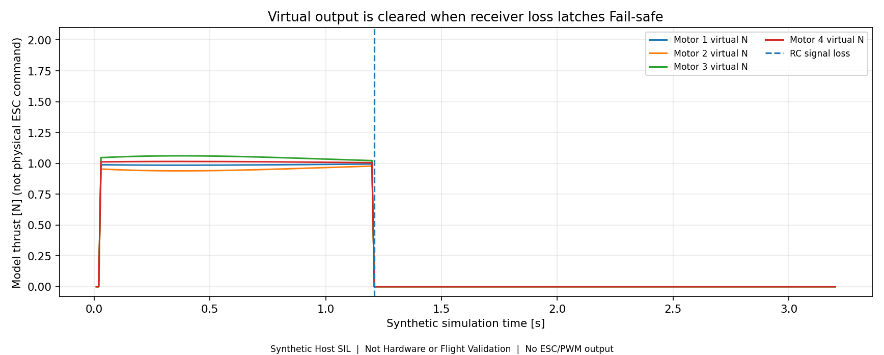

# STM32 Flight System

**STM32F405RGT6 커스텀 비행제어 보드의 회로·PCB 설계, Roll/Pitch 제어 모델, 펌웨어 통합과 소프트웨어 검증을 기록하는 학생 개인 프로젝트입니다.**

**현재 단계 · 2026-11-06:** MATLAB/Simulink 모델과 생성 C 코드, BNO086·ICM-20602 진단 경로, 100Hz 스케줄러, Feedback Gate 및 가상 Mixer/Fail-safe를 구현하고 호스트 SIL과 ARM 컴파일을 확인했습니다. **실물 MCU 실행·센서 SPI·ESC/모터·비행은 미검증**입니다. 생산 펌웨어의 제어/출력 잠금은 유지합니다.

제조 상태는 기존 기록(2026-11-02: 부품 입고 및 제조사 수락·CAM·공정 승인 대기)을 보존합니다. 이번 소프트웨어 정리는 새로운 제조 승인이나 입고 상태 확인이 아닙니다.

## 개발 현황

| 영역 | 확인한 상태 | 남은 범위 |
|---|---|---|
| 회로·PCB / R10·R11 | 설계 및 해당 릴리스의 로컬 CAM 대조 완료 | 제조사 승인·실물 전기/EMI/열 검증 |
| 제어 모델 | 싱글·이중 루프, Roll/Pitch, anti-windup, bounded mixer 구현 | 실측 기체 파라미터와 게인 조정 |
| 코드 생성 | `LKM_AW_Core_F405` + Ctrl/Mixer, single precision, 10ms | 실제 MCU 주기 및 센서 결합 검증 |
| 센서 펌웨어 | BNO086 SPI2 부분 SHTP/SH-2, ICM-20602 SPI1 자이로/진단 구현 | 실물 통신, startup, 축/부호 확인 |
| 스케줄러·안전 | 수신 시각 비교, ring buffer, 100Hz, frame contract, 출력 잠금 | 실제 ISR 지터·RC/VBAT·ESC 검증 |
| ARM 빌드 | 공개 복사본 55개 translation unit 컴파일·링크 성공 | MCU 실행·flash 시험은 수행하지 않음 |
| 통합 Host SIL | 26,860/26,860 조건 검사, 15개 독립 시나리오 통과 | 하드웨어·비행 성능을 의미하지 않음 |

## 하드웨어 설계 — LKM_FC_V1

| 항목 | 설계 사양 |
|---|---|
| MCU | STMicroelectronics STM32F405RGT6, LQFP64 |
| IMU | CEVA BNO086 / TDK InvenSense ICM-20602 |
| Barometer | STMicroelectronics LPS22HH |
| EEPROM | Microchip AT24C08C |
| Power Protection | TPS259531 eFuse, TVS, 역극성 보호 |
| LDO | TPS7A9001, 3.3 V rail |
| Communication | SPI, I²C, UART |
| RC Input / ESC Output | iBUS / PWM 6CH |
| Debug | SWD, UART, Status LED, Buzzer |
| PCB | 36×36 mm, 4-Layer, 1.2 mm 제조 조건 |
| CAD | Altium Designer 26.3 |

### PCB 3D 배치



**Top** — 중앙의 STM32F405RGT6(U1), 왼쪽의 HSE 크리스털(Y1), 오른쪽의 18핀 PWM 헤더(J8)를 볼 수 있습니다.



**Bottom** — 뒷면에서 본 부저(BZ1)와 인터페이스 부품 배치입니다. 앞면 오른쪽의 J8 단자열이 이 시점에서는 왼쪽에 보입니다. 두 그림은 Altium Designer 26.3에서 직접 설계한 보드의 CAD 렌더링이며 실물 사진이 아닙니다.

설계의 주요 검토 대상은 MCU 전원·VCAP·클록, 센서 디커플링, SPI 귀환 경로, 전원 기동, 외부 신호 보호, 장착홀과 커넥터의 간섭입니다. 제조 데이터는 저장 PCB와 구리·드릴·부품배치를 대조했습니다.

- [회로도](hardware/LKM_FC_V1/schematic/LKM_FC_V1_Schematic.pdf): 5개 회로 블록
- [PCB Layout](hardware/LKM_FC_V1/pcb-layout/LKM_FC_V1_PCB_Layout.pdf): Top / Inner 1 / Inner 2 / Bottom
- [Assembly BOM](hardware/LKM_FC_V1/bom/LKM_FC_V1_BOM.pdf): 공장 실장용 52 MPN 그룹 / 139개 위치. 전체 회로도 부품 목록과는 범위가 다릅니다.
- [설계 설명](docs/hardware-design.md) · [제조 데이터 관리](hardware/LKM_FC_V1/manufacturing/README.md)

PDF는 2026-11-02에 확보한 문서 스냅샷입니다. 회로·레이어 내용은 유지하고, 공개용 회로도·PCB PDF의 개인 저자 메타데이터만 제거했습니다. R10/R11 검증은 해당 릴리스 시점의 증거로 구분합니다. 공개 PDF 자체를 발주용 Gerber나 새로운 제조 승인으로 취급하지 않습니다.

## MATLAB/Simulink 제어 개발

P/PI/PID 비교에서 Roll/Pitch cascade 제어, 포화된 모터 모델의 achieved torque를 되먹임하는 anti-windup까지 확장했습니다. 최종 `LKM_AW_Ctrl_F405` 생성 코드의 구성은 **외부 각도 P(2.0), 내부 각속도 PI(Kp=0.05, Ki=0.2), tracking gain 2.0, Ts=0.01s**입니다. PID 계열 개발 과정과 최종 PI 구현을 구분하며 실기체용 튜닝값으로 주장하지 않습니다.

`LKM_AW_Core_F405`는 Ctrl/Mixer를 참조합니다. 입력은 각도 rad·각속도 rad/s·총 모델 추력 N, 출력은 가상 모터 추력 N 및 토크 N·m입니다. Mixer는 4개 출력에 0~2N 시험 제한을 두며 yaw 계수는 0입니다. 완성된 3축 비행제어기가 아닙니다.

[모델·파라미터·생성 코드 대응](docs/control-models.md) · [모델](control/simulink/) · [MATLAB 재현 도구](control/matlab/) · [기존 응답 비교 결과](control/simulations/)

## STM32 펌웨어 구성



위 제어 체인은 호스트 fixture에서 합성 입력으로 검증했습니다. `main.c`의 진단 service 연결과 ARM 빌드가 존재하지만 `DualIMU_Init(false)`, Shadow off, frame lock, actuator hard lock을 유지합니다. 실제 iBUS·VBAT·GPS·LPS22HH·EEPROM·ESC 출력 경로 전체가 구현됐다고 주장하지 않습니다.

[펌웨어 구조](docs/firmware-architecture.md) · [빌드·의존성](docs/reproduction.md) · [소스·라이선스 범위](docs/source-and-license.md)

## 통합 SIL 결과

원본 실행 `sil_v1_20261106_040855`와 공개 복사본의 재실행 결과를 대조했습니다. **26,860은 반복 조건 검사 수이며 독립 시험 시나리오는 15개**입니다. 정상 조건에서 1,000회 가상 100Hz step, fault/recovery 14개, 생산 hard lock 13/13, runner 안전성 10/10을 확인했습니다. 수신 timestamp 비교는 물리적 IMU 취득시각 동기화가 아닙니다.

다음 네 그래프는 **Synthetic Host SIL / Not Hardware or Flight Validation**입니다. 플랜트는 임의의 J=0.025kg·m², D=0.11N·m·s/rad이며 실제 QAV210을 식별한 모델이 아닙니다. 출력 N은 PWM/DShot 또는 실측 추력이 아닙니다.









[6단계 검증과 나머지 그래프](docs/validation.md) · [실제 실행 CSV/JSON/보고서](testing/offline-sil/results/sil_v1_20261106_040855/) · [재현 절차](docs/reproduction.md)

## 실물 검증과 다음 단계

실제 LKM_FC_V1 MCU 실행, SPI 통신, 장착 축, 100Hz 지터, 수신기·배터리, ESC PWM·모터 및 비행 시험은 아직 수행하지 않았습니다. 부품·제조 조건을 확인한 뒤 전원/SWD → 센서/축 → 주기·통신 → 프로펠러 없는 ESC bench → 기체 통합 → 비행 순서로 별도 검증합니다.

QAV210 계열 기체 통합은 예정입니다. PCB의 PWM6CH는 J8 18핀 헤더이며 현재 모의 Mixer는 4개 모터만 대상으로 합니다. J1·J4·J5·J8 수동 납땜, Molex J2·J3 공장 조립 방침을 유지합니다. 실물 사진·센서 데이터·비행 영상 폴더는 증거가 생긴 뒤 채웁니다.

## 로컬 재현

Python 3.10 이상과 host GCC/Clang을 준비하고 저장소 루트에서 실행합니다. 그래프에는 Matplotlib이 필요합니다.

```text
python -m pip install -r testing/offline-sil/requirements.txt
python testing/offline-sil/run_integrated_sil.py
python testing/offline-sil/tests/test_runner_safety.py
```

결과는 `.local/sil-runs/`의 새 폴더에 저장하며 원본 검증 CSV를 덮어쓰지 않습니다. 자동 flash/모터 출력은 없습니다. MATLAB·ARM 별도 실행 방법과 한계는 [재현 문서](docs/reproduction.md)를 참고합니다.

## 저장소 구조

```text
hardware/LKM_FC_V1/   기존 회로도·레이아웃·BOM PDF와 제조 기록
control/simulink/    선별한 모델 21개 (참조 모델 포함)
control/matlab/      원본 분석 복사본·setup·Normal/SIL 실행·파라미터 목록
control/simulations/ 기존 응답 분석 기록
firmware/stm32/      최소 CubeIDE 프로젝트와 실제 설치된 C/H
firmware/drivers/    단일 원본 코드 위치 및 모듈 안내
firmware/generated/  모델 ↔ 생성 코드 매핑 (중복 C 복사 없음)
testing/offline-sil/ 실제 회귀 runner·test·trace·6단계 근거
testing/plots/       실제 trace CSV 기반 PNG 6장
testing/bench-tests/ 실물 시험 결과 없음
testing/flight-tests/비행 시험 결과 없음
docs/               구조·검증·재현·출처·무결성
media/              실물/조립 자료 준비 위치
```

원본 CAD, 제조 ZIP, 구매/계정 정보, vendor HAL/CMSIS, build/cache, 과거 패키지 전체는 포함하지 않습니다. 새 저장소 LICENSE를 부여하지 않았습니다. 생성 코드의 Academic License와 ST 저작권 표시는 유지하며 [출처 및 사용 조건](docs/source-and-license.md)을 따릅니다.
