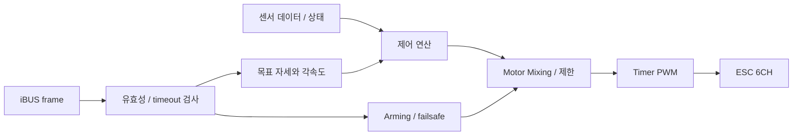

# System Architecture

[프로젝트 개요](../README.md) · [하드웨어 설계](hardware-design.md)

## 전체 시스템 개요

LKM_FC_V1은 STM32F405RGT6를 중심으로 센서, RC 입력, ESC 출력, GPS, Telemetry를 연결하는 Flight Controller PCB입니다. 아래 연결은 회로 설계 기준이며, 센서 취득과 제어 루프의 실제 시간 동작은 아직 보드에서 검증하지 않았습니다.

| 블록 | 연결 | 목적 / 현재 경계 |
|---|---|---|
| BNO086 | SPI2, CS/INTN/RESET/WAKE | 부분 SHTP/SH-2 진단·파서 구현; 실물 통신·축 미검증 |
| ICM-20602 | SPI1, CS/INT | SPI1 자이로 진단 구현; 실물 취득 미검증 |
| LPS22HH | SPI3, CS/INT_DRDY | 기압 취득 및 고도 추정에 사용 예정 |
| AT24C08C | I2C1, WP | 설정·게인 저장 계획 |
| FS-iA6B | UART5 / iBUS | 조종 입력 수신 및 유효성·timeout 검사 예정 |
| GPS M8N | UART4 | 위치·속도 데이터 수신 계획 |
| Telemetry | USART1 | 상태·명령 통신 계획 |
| Debug / 로깅 | USART6 | bring-up 진단 출력 구현; 실제 UART 파형 미검증 |
| ESC | TIM5 CH1~4, TIM2 CH3~4 | PWM1~6 회로 배정; 최종 프로토콜·타이밍 시험 필요 |

## MCU와 센서 구조

ICM/SPI1 5.25 MHz, BNO/SPI2 2.625 MHz, LPS/SPI3 5.25 MHz는 설계상 설정값입니다. 실제 firmware register 및 파형을 측정한 값은 아닙니다. BNO/ICM 진단 경로는 오류·receipt timestamp·상태를 전달하도록 구현했습니다. SPI1/2 코드 설정을 확인했으나 SPI3 등 전체 FC 펌웨어는 미완성입니다.

BNO086과 ICM-20602를 함께 사용하지만, 이 사실만으로 이중화 비행제어나 failover가 구현됐다고 주장하지 않습니다. 센서 사용 역할과 융합·교차 비교 방식은 모델 개발과 실제 시험에서 결정합니다.

## RC 수신 및 ESC 제어 흐름

도식은 전체 목표 흐름입니다. 생성 Roll/Pitch 제어, 가상 Mixer/Guard는 host SIL에서 검증했지만 실제 iBUS 수신·PWM backend와 전체 기체 루프는 구현/실물 확인이 남아 있습니다. PWM5=PB10/TIM2_CH3, PWM6=PB11/TIM2_CH4를 사용하며, PWM1~4와 함께 출력 주기·펄스폭·기동 상태를 확인해야 합니다. 보드는 6채널을 제공하고 현재 기체 구성에서는 4개 모터를 우선 사용할 계획입니다.

J8은 18핀 통합 헤더입니다. 채널별 신호와 GND를 제공하며 가운데 전원 위치는 현재 회로에서 open입니다. 이를 ESC 전원 공급선으로 임의 해석하지 않습니다. 정확한 접점은 [회로도 PDF](../hardware/LKM_FC_V1/schematic/LKM_FC_V1_Schematic.pdf)의 5번째 시트를 기준으로 확인합니다.

## GPS / Telemetry 인터페이스

GPS J2와 Telemetry J3는 Molex 53047-0510 계열 5핀 커넥터를 사용합니다. Debug와 iBUS는 별도 헤더로 분리했습니다. 외부 수신 신호는 SN74LVC1G17 버퍼와 ESD 보호를 거치며, MCU 로직은 3.3 V 기준입니다. 기체에 연결하기 전 TX/RX, GND, 전원 및 상대 모듈의 허용 레벨을 확인합니다.

## 전원 및 시스템 경계

외부 BEC 5 V → TVS/역극성 보호 → TPS259531 eFuse → 5V_PROT → TPS7A9001 LDO → 3V3 구조입니다. VBAT 입력은 배터리 전압 측정용이며 MCU VBAT 전원 핀과 구분합니다. BLDC 모터 전력은 이 보드의 3.3 V rail에서 공급하지 않습니다.

센서 축, 모터 매핑, RC failsafe, 통신 지연 및 배터리 계측 교정은 [실물 검증 계획](validation.md)에 포함합니다.
