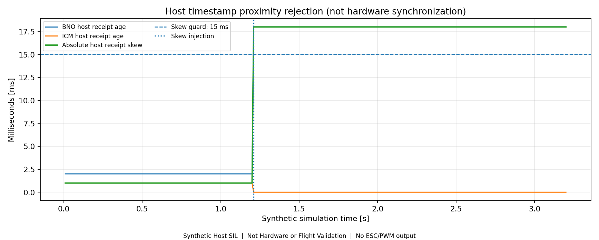
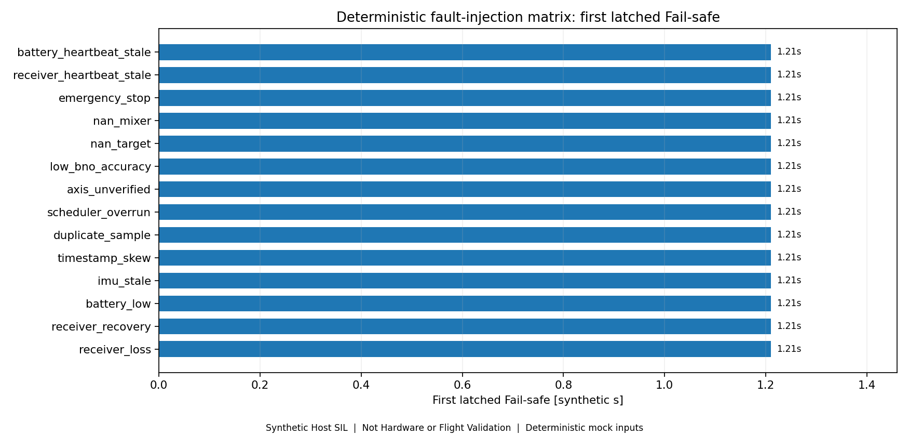

# Validation — 소프트웨어 증거와 실물 시험의 경계

[프로젝트 개요](../README.md) · [하드웨어](hardware-design.md)

## 현재 확인한 범위

| 근거 | 확인한 내용 | 포함하지 않는 보증 |
|---|---|---|
| R10, 2026-10-30 | native 제조 출력과 로컬 CAM, DRC 기록 | 제조사 최종 수락·실물 동작 |
| R11, 2026-10-31 / Stage157 | Gerber 13레이어 대조, native 배선·패드·GND, NC Drill, BOM/CPL 정합성 | EMI·열·센서 성능·비행 |
| PDF 공개 자료, 2026-11-02 | 회로도 5페이지 / PCB 4페이지 / BOM 2페이지. 내용 유지, 회로도·PCB PDF의 개인 저자 메타데이터만 제거 | 새로운 CAD 변경 검증이나 제조 승인 |

R11 로컬 결과는 96 Net / 448개 연결 핀, PTH 322 / NPTH 4, 공장 BOM 52 MPN 그룹 / CPL 139개(Top 70, Bottom 69)입니다. 누락 pad center, 분리 net 및 혼합 net 구리 그룹은 0건이었습니다. 이 결과는 해당 릴리스에 한정한 파일 비교입니다.

DRC는 전체 0건이 아닙니다. R10에 실크–마스크 230건과 J8 실크/경계 8건이 남아 있고, R11은 동일 저장본의 기존 결과를 승계했습니다. 공장 clipping 후 표식, 마스크·스텐실 공정, via cap 평탄도 및 실제 부품 방향의 승인은 별도입니다.

## 2026-11-06 소프트웨어 검증

**모든 아래 수치는 host 또는 compile-only입니다. 실물/비행 시험이 아닙니다.** 과거 실행 증거와 이번 공개 복사본 재현을 구분합니다.

| 단계 | 실제 원본 로그의 결과 | 공개 자료 |
|---|---|---|
| 1. 수신 시각·UART | time pair 46/46, timed diag 44/44, UART 60/60 | [historical evidence](../testing/offline-sil/evidence/) |
| 2. 100Hz·buffer | scheduler 139/139, bridge mock 37/37 | 같은 evidence의 fc100hz 기록 |
| 3. 생성 PID ARM 통합 | preview 47/47, parser/gate/model 26/26, shadow 49/49, production 10/10; 패키지 합계 147/147은 installer 검사 포함 | aw_shadow 기록, [이번 ARM 재현](reproduction-results.md) |
| 4. 좌표계·Feedback | gate 40/40+9/9, frame 141/141·83/83·25/25·29/29, 패키지 합계 304/304 | rp_frame / rp_feedback 기록 |
| 5. 가상 Mixer·Fail-safe | guard 76/76, generated mixer 55/55, stack 25/25, production 28/28, monitor 34/34; installer 포함 247/247 | actuator_safety 기록 |
| 6. 통합 SIL | 26,860/26,860 반복 조건 검사; 독립 시나리오 15; 정상 1,000 virtual steps; fault/recovery 14 | [실제 CSV/JSON/보고서](../testing/offline-sil/results/sil_v1_20261106_040855/) |

단계별 분모는 테스트 함수/조건/installer unit가 혼합되어 있으므로 단순 합계를 전체 독립 시험 수로 쓰지 않습니다. 마지막 15개 시나리오 중 정상 1개, 오류·복구 14개입니다. 첫 fault는 합성 시간 1.21s이며 입력을 고정한 deterministic fixture 결과입니다.

이번 공개 복사본에서 통합 SIL, production hard lock 13/13, runner safety 10/10과 ARM compile/link를 재실행했습니다. 명령·종료코드·환경·MATLAB 결과는 [재현 결과](reproduction-results.md)에 기록합니다. C/헤더의 코드 생성 `Validation result: Not run` 표시는 원본 생성기의 메타데이터로 유지하며 후속 독립 시험과 혼동하지 않습니다.

## CSV 기반 그림과 한계

**Synthetic Host SIL / Not Hardware or Flight Validation.** 앞의 네 그래프는 [README](../README.md)에 있습니다. 6장은 동일 원본 CSV를 plot_sil.py로 읽어 생성했습니다. `t_s`, angle deg, motor model N, guard state, receipt age/skew 및 first latched fault 필드를 사용합니다. 새 실측 값을 보간하거나 만들어 넣지 않았습니다. virtual output이 무효인 모든 행에서 네 추력은 0, esc_enabled/controller_ready는 전체 행에서 0입니다.

원본 trace SHA-256: `e326a9e2616627b3c9c04381fd790ff7476d128b04b94dc9c59434451621a432`.
플랜트 J=0.025kg·m² / D=0.11N·m·s/rad는 임의의 합성 가정입니다. 신호 잡음·공력·추진계 지연·진동·센서 물리 동기화·실시간 스케줄링을 재현하지 않습니다. 상태의 `ARMED_VIRTUAL`은 실제 ESC 아밍이 아닙니다.

## 아직 수행하지 않은 실제 보드 시험

아래는 시험 계획이며 PASS/측정값이 아닙니다. 다른 보드나 강의 장비에서 얻은 결과는 LKM_FC_V1 시험으로 옮겨 적지 않습니다.

| 단계 | 확인 항목 | 남길 증거 | 현재 상태 |
|---|---|---|---|
| PCB 전원 및 SWD | 조립 외관, 단락, 전류 제한 전원, 5V/3V3·기동, reset/boot, SWD 연결 | 조립 사진, 전원 파형, 전류, 연결 로그 | 미실시 |
| IMU 센서 | ID, 설정 readback, raw data, BNO startup, 정지 bias·축 방향, 기압 응답 | 펌웨어 버전, 로그, 단위·방향표 | 미실시 |
| 통신 | iBUS 유효 프레임·timeout, GPS, Telemetry, Debug, EEPROM | 케이블 핀맵, UART/SPI 파형, 오류 카운터 | 미실시 |
| ESC/PWM | 6CH 주기·펄스폭, 기동/비활성 상태, failsafe, ESC 수용 여부 | 오실로스코프 측정, 모터 매핑 | 미실시 |
| 실시간 로깅 | timestamp, sample interval, 데이터 누락·지연, 노이즈 | 원본 센서 로그, 분석 코드, 그래프 | 미실시 |
| 기체 장착 | 진동 방지, 장착물 간격, 축·모터 방향, 배선 고정 | 기체 사진, 연결표, 점검 기록 | 미실시 |
| 비행 검증 | 지상 점검 통과 후 단계적 비행과 응답 확인 | 조건, 로그, 영상, 이상·재시험 기록 | 미실시 |

ESC/모터의 초기 bench 시험은 프로펠러를 제거한 상태로 진행합니다. 수치 합격 기준은 시험 전에 설계 요구사항과 사용 장비 조건을 명시하여 정하며, 결과를 확인한 뒤 기준을 바꾸어 PASS로 만들지 않습니다.

## 기록 규칙

각 시험은 날짜, 보드 revision, firmware commit/version, 사용 장비, 입력 조건, 사전 합격 기준, 관측값, 결론과 미해결 사항을 포함합니다. 실패·중단 결과도 남기고 다음 시험에서 무엇을 변경했는지 구분합니다.

- 원본 데이터: `testing/sensor-data/`
- 분석 및 시각화: `testing/plots/`, `control/matlab/`
- 전원·센서·통신·ESC 시험: `testing/bench-tests/`
- 비행 기록: `testing/flight-tests/`
- 조립 사진: `media/assembly/`, 영상 링크 기록: `media/flight-videos/`

## 다음 확인 순서

부품 입고와 제조사 수락·CAM/배치 승인을 확인한 뒤 PCB 제작·조립을 진행합니다. 실제 보드를 수령하면 전원/SWD → 센서 → 통신 → PWM/ESC → 기체 통합 → 비행 순으로 검증합니다. 현재는 제조 대기 단계이며 실물 검증 결과를 게시할 단계가 아닙니다.
